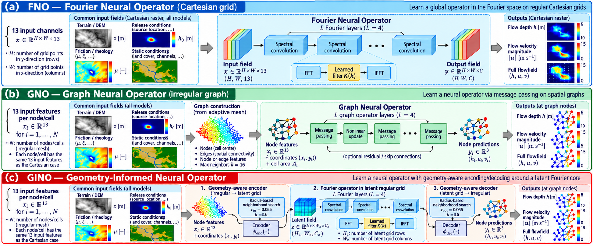

<div align="center">

# Physics-Aware Neural Operators for Multiphysics Debris-Flow Modeling

**A comparative study of Fourier, Graph, and Geometry-Informed Neural Operators on Cartesian and terrain-adapted discretizations**



*Figure — Common physical inputs and the six surrogate variants built from FNO, GNO, and GINO architectures.*

</div>

## Overview

This repository provides the research code for a controlled, **site-specific** surrogate-model comparison of three neural operator families: Fourier Neural Operator (FNO), Graph Neural Operator (GNO), and Geometry-Informed Neural Operator (GINO). Each is evaluated with **Cartesian (C)** and **terrain-adapted (A)** spatial representations. The models learn mappings from physical input fields and scenario parameters to debris-flow state predictions (including flow depth and velocity).

The aim is **not** to develop a new debris-flow solver or a single global model for arbitrary topographies. Rather, the workflow trains local surrogates for a *fixed area of interest* while varying the physical forcing and material parameters. This strategy supports rapid scenario exploration and can complement physics-based simulations in site-specific hazard and risk assessment. The high-fidelity reference trajectories were generated with the separately maintained [PyDebrisFlow2D](https://github.com/Secchi93/PyDebrisFlow2D) solver. These neural models approximate that solver's numerical responses; comparisons against solver outputs are **not** independent field validation.

The source code is hosted on GitHub; the large **dataset, fitted checkpoint weights, and training histories** are distributed separately through Zenodo. Nothing in `output/` needs to be committed to GitHub.

## Study design

| Property | Protocol |
| --- | --- |
| Model families | FNO, GNO, GINO |
| Spatial representations | Cartesian and adaptive (6 combinations) |
| Input features | 13 input channels/features per grid cell or graph node |
| Training | 200 epochs, seed `1234` |
| Dataset | 6 terrain profiles × 50 parameter scenarios = 300 scenarios, simulated on 2 discretizations (600 solver runs) |
| Splits (scenarios) | Train 180; validation 30; IID test 30; single-OOD test 30; joint-OOD test 30 |
| Spatial discretizations | Cartesian 10 m; adaptive 10/12.5/15 m, per generator configuration |
| Time horizon/output interval | 1000 s / 20 s, per generator configuration |
| Shared geometric-neighbor limit | `K=16` for GNO and GINO graph operations |

The **same six terrain profiles occur in all splits**; OOD means extrapolation in *physical parameters*, not unseen topographic regions. For the precise parameter ranges, physical settings, optimizer settings, losses and architectures, see `configs_ml/morino_dataset.yaml` and the six files in `configs_ml/comparison/deep200/`.

## Data, code and external dependencies

- **This repository (GitHub):** data preparation, training, evaluation, inference, benchmarking, plotting and configuration files.
- **Dataset (Zenodo):** the `dataset/` directory with `manifest.csv`, HDF5 trajectories and mesh/profile files, plus the original `target_scales.json`. DOI: **https://zenodo.org/records/23313028**.
- **Trained models (Zenodo):** the six main `deep200` checkpoints, original training `history.json` records, and the optional `deep200_wpos4` / `deep200_wpos16` FNO-C ablation checkpoints. DOI: **https://zenodo.org/records/23313028**.
- **External forward solver:** [PyDebrisFlow2D](https://github.com/Secchi93/PyDebrisFlow2D); its source code is **not included here**.

> **Reproducibility note:** PyDebrisFlow2D `1.4.0`, installed from GitHub commit `02f2102680f6d0e7d8c0b0a9d0bfa5cd387ba796`, passed the external import smoke check during repository testing. This alone does **not** establish that it is the exact revision originally used to create the dataset. Do not replace the original published trajectories when checking the pretrained surrogate results.

## Repository layout

```text
.
├── assets/
│   └── neural_operator_architectures.png   # README cover
├── configs_ml/
│   ├── morino_dataset.yaml               # Forward-simulation configuration
│   └── comparison/deep200/              # Six model YAML configurations
├── ml/                                  # Data readers, models, operators, losses, metrics
├── output/                              # Local-only: NOT committed to GitHub
│   ├── dataset/                         # Extract dataset from Zenodo
│   │   ├── manifest.csv
│   │   ├── runs/
│   │   └── profiles/
│   ├── target_scales.json               # Original normalization scales from Zenodo
│   ├── models/
│   │   ├── deep200/                     # Six model folders with best.pt + history.json
│   │   ├── deep200_wpos4/               # Optional ablation
│   │   └── deep200_wpos16/              # Optional ablation
│   ├── evaluation/                      # Suggested outputs from evaluation.py
│   ├── figures/                         # Paper plots
│   └── inputs/                          # Optional DEM/geometry for regeneration
├── build_dataset.py                    # Generate reference trajectories (optional)
├── compute_scales.py                   # Calculate normalization (optional)
├── train.py                            # Train one model
├── evaluation.py                       # Evaluate one pretrained checkpoint
├── inference.py                        # Same-scenario six-model inference & visualizations
├── inference_ood.py                    # Same-profile OOD inference
├── plots.py                            # Training / temporal / profile figures
├── benchmark.py                        # Solver / surrogate timing benchmark
├── summarize_comparison.py             # Summarize evaluation results
├── validate_protocol.py                # Check controlled training protocol
├── smoke_test.py                       # Static, dataset, solver & GPU checks
├── run.py                              # Orchestrate six-model validation/training/evaluation
├── requirements.txt
└── LICENSE
```

The former `study/` directory and long versioned dataset folder have been standardized to **`output/`** and **`output/dataset/`**. Normalization scales must be at **`output/target_scales.json`**. The source code does not embed the dataset, solver or model weights. For scientific reproducibility, do not edit the internals of downloaded HDF5 datasets or checkpoints.

## Installation

**Prerequisites:** Git, a compatible Python installation (the test environment used Python 3.13), and a CPU- or CUDA-compatible PyTorch installation. A suitable NVIDIA GPU is recommended for the six-model tests and full-scale evaluation. The verified GPU test environment used PyTorch `2.11.0+cu128` with an NVIDIA RTX 5060 Laptop GPU; other compatible setups may work.

From **Windows CMD / Anaconda Prompt** (commands shown for this environment):

```cmd
conda create -n neural-operators python=3.13 -y
conda activate neural-operators

git clone [ADD_GITHUB_URL]
cd [REPOSITORY_NAME]
```

Install [PyTorch](https://pytorch.org/get-started/locally/) using the **official command for your platform and CUDA driver**, then install this repository's requirements:

```cmd
python -m pip install --upgrade pip
python -m pip install -r requirements.txt
```

Install **PyDebrisFlow2D as an independent package** (required for solver and dataset-generation workflows and for `--solver` checks):

```cmd
python -m pip install git+https://github.com/Secchi93/PyDebrisFlow2D.git
python -c "import pydebrisflow; print(pydebrisflow.__file__)"
```

The import path should point to your installed Python `site-packages`, **not** to a `pydebrisflow/` folder copied into this repository. For strict forward-solver reproduction, pin the installation to the exact original solver commit once confirmed, rather than using a moving GitHub default branch.

## Obtain the archived dataset and models

Download the Zenodo records linked above and extract the files to the following locations, retaining the original internal folder hierarchy:

```text
output/dataset/manifest.csv
output/dataset/runs/<scenario_id>/cartesian/run_data.h5
output/dataset/runs/<scenario_id>/adaptive/run_data.h5
output/dataset/profiles/...
output/target_scales.json
output/models/deep200/fno_cartesian_seed1234/best.pt
output/models/deep200/fno_adaptive_seed1234/best.pt
output/models/deep200/gno_cartesian_seed1234/best.pt
output/models/deep200/gno_adaptive_seed1234/best.pt
output/models/deep200/gino_cartesian_seed1234/best.pt
output/models/deep200/gino_adaptive_seed1234/best.pt
```

Include `history.json` inside **each** of the six model folders if you want to regenerate the original 200-epoch training plots. If you have the optional `w_pos` ablation checkpoints, place them under `output/models/deep200_wpos4/` and `output/models/deep200_wpos16/`, respectively. `best.pt` alone is sufficient for normal pretrained-model inference/evaluation, **not** for reconstructing a complete training history.

Do **not** recalculate `target_scales.json` for the pretrained benchmark; use the archived scales. Note that original `best.pt` files retain historical training paths in their metadata. Current inference/evaluation scripts resolve the manifest from `output/dataset/manifest.csv` (or explicit command-line arguments) instead. The original checkpoints remain untouched.

## Smoke tests (recommended first)

Run these from the repository root:

```cmd
python smoke_test.py
python smoke_test.py --data --solver
python smoke_test.py --gpu
```

The first test checks Python source syntax, all six YAML configs and the 200-epoch protocol. The second requires the archived dataset/scales and externally installed PyDebrisFlow2D. The GPU test performs a **short forward/backward and validation check** for all six models on real data; **it does not retrain for 200 epochs**, nor does it assess accuracy of the archived `best.pt` weights.

The smoke tests were observed to pass for all six configurations on a CUDA GPU using the supplied dataset. Full numerical reproducibility still requires full evaluation and comparison with the published tables.

## Pretrained inference (no retraining)

To run all six architectures on one IID scenario (if no scenario ID is specified, the script chooses one available in the selected split):

```cmd
python inference.py --tier deep200 --seed 1234 --split iid_test --times 50 --dataset-root output/dataset
```

To request a particular scenario:

```cmd
python inference.py --tier deep200 --seed 1234 --split iid_test --scenario p01_s0035 --times 50 --dataset-root output/dataset
```

`--times` specifies a requested physical time; the program selects the nearest stored reference snapshot (therefore an actual time around 40 s may be used when 50 s is requested). Omit `--case` for all six or specify a case such as `--case gino_adaptive`.

The current implementation writes same-sample figures and `same_sample_metrics.csv` into the run's `output/models/deep200/same_sample_inference_200/` subdirectory unless redirected with `--out`. To keep generated results separate from downloaded checkpoints, you can explicitly request an output directory:

```cmd
python inference.py --tier deep200 --seed 1234 --split iid_test --times 50 --dataset-root output/dataset --out output/inference/iid_example
```

Metrics computed on adaptive native cells and Cartesian native grids use distinct reference spaces; the adaptive FNO output is back-projected to the original adaptive cells for its primary metrics.

## Quantitative evaluation

For a full evaluation of the six models, with first-arrival time computed from the **complete sequence of frames**:

```cmd
python evaluation.py --checkpoint output/models/deep200/fno_cartesian_seed1234/best.pt --manifest output/dataset/manifest.csv --splits iid_test single_ood_test joint_ood_test --frame-stride 1 --out output/evaluation/fno_cartesian
```

Replace `fno_cartesian` consistently in the checkpoint path and output folder with each of `fno_adaptive`, `gno_cartesian`, `gno_adaptive`, `gino_cartesian`, and `gino_adaptive`. The script writes `frame_metrics.csv`, `scenario_metrics_post_t0.csv`, `trajectory_metrics.csv` and `summary.json` to the chosen output directory.

**Important:** use `--frame-stride 1`. The evaluator rejects skipped frames because temporal subsampling invalidates first-arrival estimates. Evaluation reports depth, wet support, speed, arrival, runout and other published metrics as available in the code. The three test splits are `iid_test`, `single_ood_test` and `joint_ood_test`; do not invent alternate split names.

A full six-model evaluation can also be initiated with `python run.py --stage evaluate`, but by default this uses its own model-specific output locations. For a clearly separated `output/evaluation/` tree, use the explicit commands above.

## Figures for the article

### Training convergence

Requires all six `history.json` files from the model archive:

```cmd
python plots.py training --root output/models/deep200 --out-dir output/figures/training
```

Produces six individual PNG curves and `all_six_training_curves_200ep_a-f.png`. **Do not** attempt to recreate training histories from `best.pt` metadata.

### Temporal depth error and wet-area overlap

`plots.py temporal` **reads existing `frame_metrics.csv` files**; it does not rerun inference. Its default input convention is `output/models/deep200/<case>_seed1234/evaluation/frame_metrics.csv`. For FNO-C, GNO-A and GINO-A on the joint-OOD split, generate those inputs as follows:

```cmd
python evaluation.py --checkpoint output/models/deep200/fno_cartesian_seed1234/best.pt --manifest output/dataset/manifest.csv --splits joint_ood_test --frame-stride 1 --out output/models/deep200/fno_cartesian_seed1234/evaluation
python evaluation.py --checkpoint output/models/deep200/gno_adaptive_seed1234/best.pt --manifest output/dataset/manifest.csv --splits joint_ood_test --frame-stride 1 --out output/models/deep200/gno_adaptive_seed1234/evaluation
python evaluation.py --checkpoint output/models/deep200/gino_adaptive_seed1234/best.pt --manifest output/dataset/manifest.csv --splits joint_ood_test --frame-stride 1 --out output/models/deep200/gino_adaptive_seed1234/evaluation
python plots.py temporal --tier deep200 --split joint_ood_test --scenario p01_s0048 --out output/figures/temporal/joint_ood_test_p01_s0048
```

This produces `temporal_rmse_h.png/.pdf`, `temporal_iou.png/.pdf` and `temporal_error_evolution.csv`. A chosen scenario must actually exist in the evaluation records; adjust `--scenario` and (if necessary) the requested time range to match the dataset snapshots. **These evaluations will be written alongside the downloaded model folders** because that is the current plot reader's convention; they are still ignored by Git.

### Terrain context/profile figure

Requires the original dataset outputs for scenario `p03_s0043` plus an orthophoto GeoTIFF, supplied separately:

```cmd
python plots.py profile --dataset-root output/dataset --orthophoto output/inputs/orthophoto.tif --out output/figures/profile.png
```

The path above is an **example**; supply the actual image path. The figure compares the Cartesian and adaptive PyDebrisFlow2D final states on hillshade and orthophoto backgrounds.

For additional plots generated by `inference.py`, see the inference output directory. `python plots.py --help` lists the available plot modes; individual plotting arguments are passed after the mode name.

## Optional: train or regenerate reference simulations

To verify the six-model protocol without retraining:

```cmd
python run.py --stage validate
```

To train one model from scratch:

```cmd
python train.py --config configs_ml/comparison/deep200/fno_cartesian.yaml --seed 1234
```

`python run.py --stage train` trains all six; `python run.py --stage all` trains then evaluates. These commands are computationally expensive and **not needed** for pretrained inference or evaluation. Confirm output directories and avoid overwriting downloaded checkpoints.

To generate a *new* forward-model dataset rather than use the original Zenodo archive, first provide a suitable DEM archive at `output/inputs/dem.zip` (expected member `DEM/DemMosaic_WGS84_33N.asc`) and prepared geometry at `output/inputs/geometry.json`:

```cmd
python build_dataset.py --config configs_ml/morino_dataset.yaml --design-only
python build_dataset.py --config configs_ml/morino_dataset.yaml --mode both
python compute_scales.py --manifest output/dataset/manifest.csv --out output/target_scales.json
```

Dataset generation requires a compatible PyDebrisFlow2D release and valid prepared geometry, and should take place in a separate working directory to avoid modifying the paper's downloaded data. The archived scales should remain unchanged for evaluations reported in the manuscript.

For benchmarking and consolidated evaluation summaries, inspect `python benchmark.py --help` and `python summarize_comparison.py --help` for the appropriate inputs.

## Reproducibility and interpretation

The physics-based simulator provides the training and reference fields; the neural models are surrogates trained and tested over *parameter scenarios for previously specified topographies*. Therefore, IID/OOD performance does not establish transfer to arbitrary unobserved terrain. Checkpoint selection is based on the validation objective, so the best epoch may be earlier than epoch 200. Models trained with different loss weights (for example `w_pos` ablations) do not have directly comparable raw validation objectives.

Original checkpoints may include non-tensor Python objects in their stored configuration. The existing loading workflow uses PyTorch deserialization that may require `weights_only=False`. **Only deserialize checkpoints from a trusted source**, because this mode can execute arbitrary Python code.

The repository has been functionally checked on real data with six GPU smoke tests, six-model IID inference and at least one full-frame IID evaluation. These checks do not guarantee numerical identity for every model/split or a bitwise-identical regeneration of the forward dataset on other hardware.

## Citation and license

Please cite the associated journal article when available (**[ADD_ARTICLE_DOI]**), the relevant dataset/model Zenodo records and [PyDebrisFlow2D](https://github.com/Secchi93/PyDebrisFlow2D) as appropriate. Please also archive/tag the code version used for the article to make results traceable.

The repository license is provided in [`LICENSE`](LICENSE).
